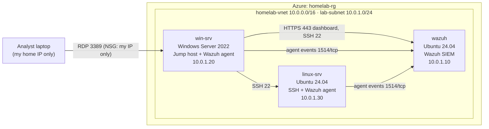

# Defensive Security Homelab: Detection, Investigation and Remediation

> **Status: work in progress.** The lab is being built now. Sections marked
> `TODO` will be filled in with real findings, screenshots and numbers as each
> phase is completed. Nothing in this repo is invented: if a result is not here
> yet, it has not happened yet.

A small simulated company network hosted in Microsoft Azure, used to
practise the day-to-day workflow of a security operations / information
security team: collect logs centrally, generate realistic security events,
investigate the alerts, research vulnerabilities against public CVE data, fix
the highest-priority ones, verify the fixes, and write it all up.

**Author:** KT ([@DrvKrv](https://github.com/DrvKrv))
**Related experience:** picoCTF, team placed 46th of 1,817 teams nationally.

---

## At a glance

| | |
|---|---|
| **Cloud** | Microsoft Azure (Azure for Students): one resource group, one VNet, three VMs |
| **SIEM** | Wazuh (manager, indexer and dashboard, all-in-one) |
| **Endpoints** | Windows Server 2022 (also the jump host), Ubuntu Server 24.04 Linux server |
| **Access control** | Network Security Groups: only RDP to the jump host, only from my IP; everything else private |
| **Telemetry** | Windows Security event log, Linux `auth.log` / syslog, firewall logs |
| **Exercises** | Failed logins, account changes, blocked connections, authorized port scans |
| **Outputs** | Asset inventory, network diagram, incident report, remediation tickets, security policy, CVE worksheet |

## Lab architecture



Only `win-srv` has a public IP. The SIEM and the Linux server are reachable
only from inside the VNet. See the full [network diagram](docs/network-diagram.md)
and [asset inventory](docs/asset-inventory.md).

### Why the cloud

The lab runs in Azure rather than on my laptop, which added a second skill
set to the project: designing a small cloud network, limiting exposure with
Network Security Groups and a single jump host, and controlling cost
(budget alerts, auto-shutdown, deallocating VMs when idle).

## What I did

### 1. Built a cloud lab network
`TODO` Short description of the Azure setup: resource group, VNet and subnet,
static private IPs, which NSG rules exist and why, how I confirmed nothing but
RDP from my IP is reachable from the internet, and the budget and
auto-shutdown guardrails.

### 2. Deployed a SIEM and centralized logging
`TODO` Wazuh install, agents enrolled on both endpoints, which log sources are
collected, and the Windows audit policy changes needed to see logon and
account-management events. Configs live in [`lab/`](lab/).

### 3. Simulated security incidents
All activity was generated by me, inside my own lab, against machines I own.
Scripts and step-by-step procedures are in [`lab/`](lab/).

| # | Scenario | Target | Expected evidence | Status |
|---|---|---|---|---|
| 1 | Repeated failed logins | win-srv | Event ID 4625, account lockout 4740 | `TODO` |
| 2 | SSH brute-force attempts | linux-srv | `sshd` "Failed password" in `auth.log` | `TODO` |
| 3 | Local account created and added to Administrators | win-srv | Event IDs 4720, 4732 | `TODO` |
| 4 | Blocked inbound connection | linux-srv | `ufw` BLOCK entries | `TODO` |
| 5 | Authorized port scan (nmap) | linux-srv | Firewall / connection logs | `TODO` |

### 4. Investigated the alerts
`TODO` For each scenario: what alerted, which account and host were involved,
timeline, and how I confirmed it. Full write-ups are in
[`docs/incidents/`](docs/incidents/).

### 5. Researched vulnerabilities
`TODO` Software inventory, outdated packages found by Wazuh's vulnerability
detection, matched to CVE IDs, CVSS scores and NVD records. Worksheet:
[`docs/cve-research-worksheet.md`](docs/cve-research-worksheet.md).

### 6. Remediated and verified
`TODO` Which vulnerabilities were prioritized and why, what was changed, and
the evidence that the fix worked (rescan result, alert stopped, version
number). Tickets are in [`docs/tickets/`](docs/tickets/).

## Key findings

`TODO` Three to five bullet points a reviewer can read in 30 seconds, for example:
- *What was detected, how fast, and what it would mean in a real company.*
- *The highest-severity vulnerability found, its CVSS score, and how it was fixed.*
- *One thing that did **not** alert by default, and what was changed so it does.*

## What I learned

`TODO` Honest reflections: what was harder than expected, what I would do
differently, and what I would add next.

## Repository layout

```
.
├── README.md                      This case study
├── docs/
│   ├── asset-inventory.md         Every VM, OS, role, IP, owner, criticality
│   ├── network-diagram.md         Lab topology and allowed traffic flows
│   ├── security-policy.md         Short acceptable-use / access / logging policy
│   ├── cve-research-worksheet.md  CVE, CVSS, NVD link, priority per finding
│   ├── publishing-checklist.md    What must never be committed, and how to check
│   ├── incidents/                 Incident reports (template + completed reports)
│   ├── tickets/                   Remediation tickets (template + completed tickets)
│   └── evidence/                  Redacted screenshots and log excerpts
└── lab/                           Wazuh configs and simulation scripts
```

## Scope and ethics

- Every scan and simulated attack ran inside my own Azure VNet against virtual
  machines I created. Microsoft permits testing your own Azure resources;
  nothing was pointed at other Azure customers, my home network, or anyone
  else's systems.
- No real credentials, keys, agent enrollment secrets, subscription IDs,
  public IP addresses, or unredacted logs are published. See [`docs/publishing-checklist.md`](docs/publishing-checklist.md).

## Next steps

- CompTIA Security+ (studying alongside / after this project)
- `TODO` Possible extensions once the core lab is done
