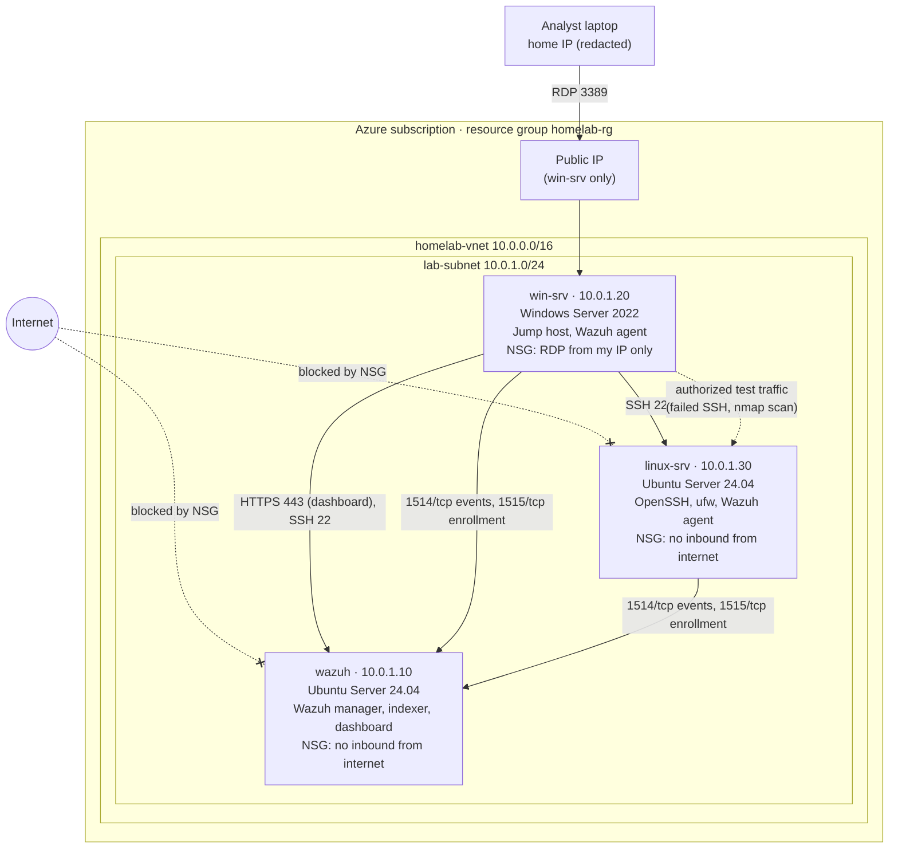

# Network Diagram

> Planned topology from the Azure setup plan. Update it to match the real
> build, then replace "planned" with "as built" and the date.

**Status:** planned · **Last updated:** `TODO YYYY-MM-DD`

## Topology

## Allowed traffic flows

| Source | Destination | Port / protocol | Purpose | Always on? |
|---|---|---|---|---|
| My home IP | win-srv (public IP) | 3389/tcp | Remote Desktop into the lab | Yes, NSG restricted to one IP |
| win-srv | wazuh | 443/tcp | Analyst uses the Wazuh dashboard (Edge on win-srv) | Yes |
| win-srv | wazuh, linux-srv | 22/tcp | Administration over SSH | Yes |
| win-srv, linux-srv | wazuh | 1514/tcp | Send security events to the SIEM | Yes |
| win-srv, linux-srv | wazuh | 1515/tcp | Agent enrollment | Only when enrolling |
| win-srv | linux-srv | 22/tcp, scan ports | Authorized incident simulations | During exercises only |
| All VMs | Internet (outbound) | 80, 443/tcp | OS updates, Wazuh packages | Yes (Azure default outbound) |
| Internet | wazuh, linux-srv | any | **Denied** (no public IP, default NSG deny) | n/a |

## Design notes

- **Single entry point:** only `win-srv` has a public IP, and its NSG allows
  RDP from one source address. This is a small version of the "jump host" or
  "bastion" pattern companies use so internal servers are never exposed.
  `TODO` describe how this was verified (e.g. a port check from outside shows
  only 3389 open, and only from my IP).
- **Static private IPs:** keep logs, alerts and this diagram consistent.
- **Single SIEM VM:** all three Wazuh components run on one VM to stay within
  the student credit. In a real company these would be separate, redundant servers.
- **Cost controls:** budget alerts, nightly auto-shutdown, and stopping VMs as
  "Stopped (deallocated)" when not in use. The resource group is deleted when
  the project ends.
- **Known risk:** RDP exposed to the internet, even from one IP, is a common
  attack path. `TODO` note whether Azure Bastion or just-in-time access was
  considered and why it was or wasn't used (cost vs. risk).

Exported image for the README (optional): `evidence/network-diagram.png` `TODO`
