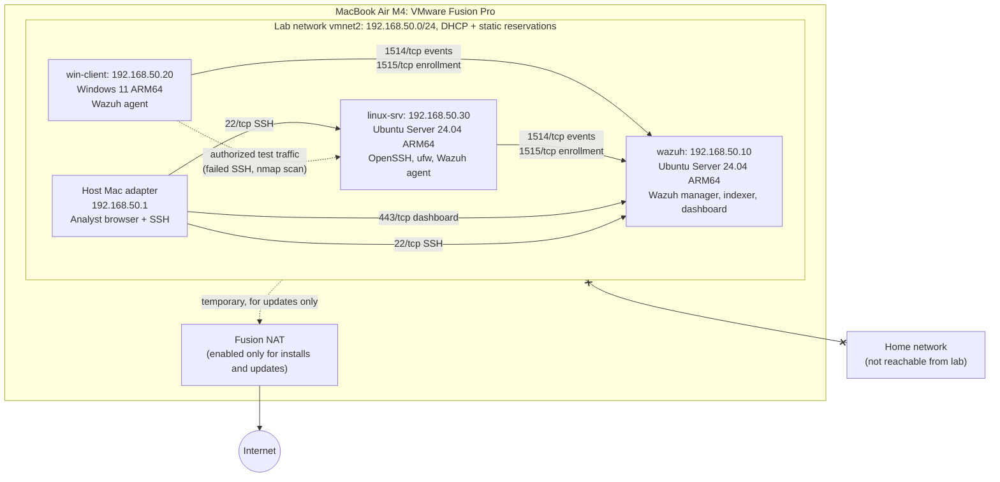

# Network Diagram

> Planned topology. Update IPs and flows to match the real build, then replace
> "planned" with "as built" and the date.

**Status:** planned · **Last updated:** `TODO YYYY-MM-DD`

## Topology

## Allowed traffic flows

| Source | Destination | Port / protocol | Purpose | Always on? |
|---|---|---|---|---|
| win-client, linux-srv | wazuh | 1514/tcp | Send security events to the SIEM | Yes |
| win-client, linux-srv | wazuh | 1515/tcp | Agent enrollment | Only when enrolling |
| Host Mac | wazuh | 443/tcp | Analyst uses the Wazuh dashboard | Yes |
| Host Mac | wazuh, linux-srv | 22/tcp | Administration over SSH | Yes |
| win-client | linux-srv | 22/tcp, scan ports | Authorized incident simulations | During exercises only |
| Lab VMs | Internet (via NAT) | 80, 443/tcp | OS and package updates | No: disabled after installs |
| Lab VMs | Home network | any | **Denied** | n/a |

## Design notes

- **Isolation:** the lab uses its own Fusion custom network so scans and
  simulated attacks cannot reach the home network or other devices.
  `TODO` describe how this was verified (e.g. ping to the home router fails from linux-srv).
- **Static addressing:** fixed IPs keep logs, alerts and this diagram consistent.
- **Single SIEM:** all three Wazuh components run on one VM to fit in 16 GB RAM.
  In a real company these would be separate, redundant servers.

Exported image for the README (optional): `evidence/network-diagram.png` `TODO`
